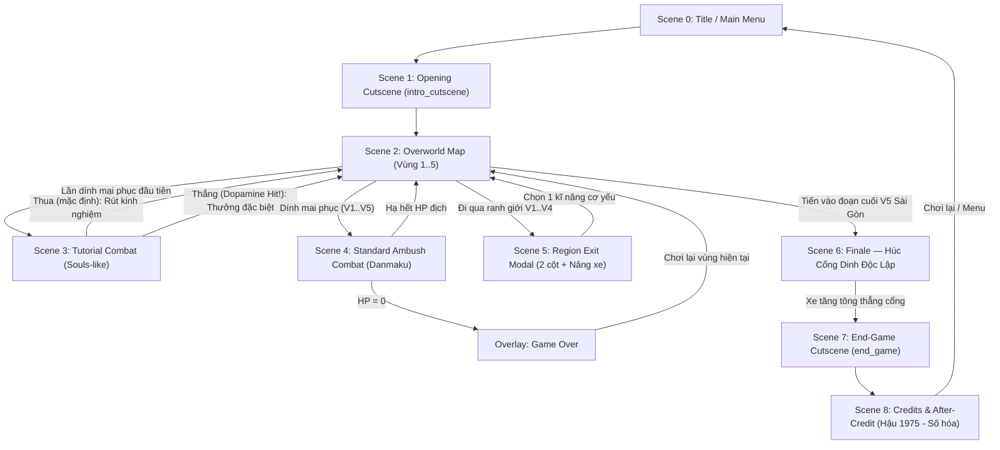

# Đặc Tả Yêu Cầu & Thiết Kế Toàn Bộ Cảnh Game — Cơ Yếu Quân Sự Việt Nam (1945–1975)

> File tài liệu gốc bất biến: [../requirements.md](../requirements.md)  
> Trạng thái tiến độ hiện tại: [../STATUS.md](../STATUS.md)  
> Danh sách task từng bước: [./ROADMAP.md](./ROADMAP.md)

---

## 1. Các Quyết Định Nền Tảng Đã Chốt (KHÔNG ĐỔI NGẦM)

| Hạng mục | Quyết định đã chốt |
| :--- | :--- |
| **Tech stack** | `Vite` + `TypeScript` + `PixiJS` (WebGL) — dùng **`pnpm`** |
| **Điều khiển** | PC: `WASD` (+ hỗ trợ Arrow keys). Mobile: chạm-kéo tương đối trực tiếp trên màn hình (relative touch drag — ngón tay không che xe/đạn). Combat mặc định **auto-fire** (`Space` bật/tắt) |
| **Bản đồ & Hitbox** | Bản đồ `2D top-down` di chuyển tự do từ đầu vùng tới ranh giới vùng. **Hitbox khớp đúng kích thước thân xe** (xe càng lớn càng khó né đạn, bù bằng HP cao + hỏa lực mạnh + kĩ năng cơ yếu) |
| **Luật thắng / thua Combat** | **Bắt buộc bắn hạ cạn HP địch** để thắng và quay lại map. **Thua Tutorial**: đi tiếp cốt truyện. **Thua màn thường**: `Game Over` → chơi lại từ đầu vùng hiện tại (giữ nguyên xe & kĩ năng đã mở trước vùng đó) |
| **Lộ trình 5 Vùng – 5 Xe** | `V1 Pháp (Xe đạp)` → `V2 Pháp++ (Xe đạp thồ)` → `V3 Ngụy (Bốn bánh)` → `V4 Mỹ (Xe tải)` → `V5 Ngụy-- / Sài Gòn (Max Xe tăng + Max toàn bộ 4 kĩ năng)` |
| **Tư liệu lịch sử** | Giữ nguyên tư liệu 1945–1953 từ [../requirements.md](../requirements.md); bổ sung phần 1954–1975 & hậu thống nhất chuẩn sử liệu ngành Cơ yếu Việt Nam |
| **Đồ họa & Âm thanh** | Đồ họa procedural top-down trên PixiJS + Web Audio API synth (Morse code, radio static, SFX bắn/trúng/vỡ cổng) |

---

## 2. Sơ Đồ Chuyển Cảnh (Scene Flow)



---

## 3. Miêu Tả Chi Tiết Toàn Bộ Cảnh Game (Scene 0 → Scene 8 + Overlays)

### Scene 0 — Title / Main Menu (`src/scenes/TitleScene.ts`)
- **Hình ảnh**: Nền bản đồ quân sự cổ, lưới số mật mã mod-10 trôi nền, vòng sóng vô tuyến nhẹ.
- **UI**:
  1. Tiêu đề game + phụ đề *Cơ Yếu Quân Sự Việt Nam (1945–1975)*.
  2. Nút **Bắt đầu chiến dịch**.
  3. Nút bật/tắt âm thanh (Web Audio SFX + Morse).
  4. Hướng dẫn điều khiển ngắn (`WASD` PC / `Chạm & kéo` Mobile).

### Scene 1 — Opening Cutscene (`intro_cutscene` — `src/scenes/CutsceneScene.ts`)
- **Mục đích**: Chạy trước khi vào map Vùng 1; cài đặt chủ đề cốt lõi.
- **3 khung diễn hoạt** (typewriter text + camera pan nhẹ + nút `Tiếp tục` / `Bỏ qua`):
  1. *12/9/1945*: Thành lập Ban Mật mã quân sự tại Bộ Tổng Tham mưu (Hoàng Đạo Thúy, Tạ Quang Đệ, Đinh Loan Thuyên).
  2. *Hai bức điện sinh tử*: Một mệnh lệnh đến muộn đẩy cả trung đoàn vào ổ mai phục; một bức điện chính xác, kịp thời quyết định thắng lợi chiến dịch.
  3. *Nhiệm vụ*: Vượt 5 thời kì kháng chiến trong vùng mù thông tin, dùng năng lực cơ yếu né mai phục và tiến vào Sài Gòn.

### Scene 2 — Overworld Map: Hành Quân & Né Mai Phục (`src/scenes/OverworldScene.ts`)
- **Góc nhìn & di chuyển**: `2D top-down` đi tự do, camera bám theo phương tiện; mục tiêu đi từ điểm xuất phát lên cửa ranh giới cuối vùng.
- **Fog of War & Mai phục**:
  - Vùng sáng rõ quanh xe bị giới hạn; ổ mai phục ẩn hoàn toàn cho đến khi kĩ năng cơ yếu quét trúng hoặc phát manh mối.
  - 5 sắc thái địa hình theo thời kì: Rừng núi Việt Bắc (`V1`) → Đồi núi Điện Biên Phủ (`V2`) → Đồng bằng/căn cứ Nam Bộ (`V3`) → Tuyến lửa Trường Sơn hố bom (`V4`) → Đại lộ tiến vào Sài Gòn (`V5`).
- **Tương tác**:
  1. Né bẫy mai phục dựa trên tầm nhìn, visual hint và manh mối ngoài map từ 4 kĩ năng cơ yếu.
  2. Lụm vật phẩm lịch sử rơi trên đường (nối chung timeline với combat).
  3. Chạm vạch ranh giới cuối `V1..V4` → mở **Scene 5**. Ở cuối `V5` → chuyển mượt vào **Scene 6**.

### Scene 3 — Tutorial Ambush Combat (`tutorial_combat` — Souls-like, `src/scenes/CombatScene.ts`)
- **Trigger**: Lần đầu tiên xe đạp chạm ổ mai phục ở `V1` (gợi nhớ bức điện đến muộn của Trung đoàn 102 / Đại đoàn 308).
- **Thiết kế Souls-like**:
  - Danmaku mật độ dày, nhịp bắn bất quy tắc, HP xe đạp chỉ có `3` → đa số người chơi sẽ gục sớm để thấm mục tiêu: **hạn chế tối đa giao tranh, dựa vào cơ yếu để né bẫy**.
  - Vẫn có thể thắng bằng kỹ năng thuần túy (không gian lận bất tử cho địch).
- **2 Nhánh kết quả**:
  1. **Thua (mặc định)**: Không Game Over. Hiện đoạn rút kinh nghiệm (*"Điện đổi đường đến muộn — đơn vị trả giá bằng máu"*), đưa xe trở lại map ngay sau ổ phục kích Tutorial để chơi tiếp.
  2. **Thắng (Dopamine Hit lớn)**: Slow-motion vỡ toàn bộ đạn, huy hiệu vàng **CHIẾN CÔNG NGOẠI HẠNG — VƯỢT BẪY MÙ THÔNG TIN**, cộng vĩnh viễn `+1 Max HP` cho mọi phương tiện suốt lượt chơi + câu thoại lịch sử đặc biệt.

### Scene 4 — Standard Ambush Combat (`combat_scene` — Touhou-like Danmaku, `src/scenes/CombatScene.ts`)
- **Trigger**: Va chạm bất kỳ ổ mai phục nào trên map từ `V1` đến `V5`.
- **Cơ chế**:
  - Đấu trường kín (PixiJS WebGL xử lý mượt hàng trăm viên đạn object-pooled).
  - Người chơi vừa né đạn (**hitbox khớp đúng thân xe**) vừa tự động xả đạn về phía địch.
  - Vật phẩm lịch sử tiếp tục rơi ngay giữa màn đấu theo đúng thứ tự timeline chung.
  - **Thắng**: Bắn cạn thanh HP địch → quay lại đúng vị trí trên map, xóa ổ mai phục đó.
  - **Thua**: `HP = 0` → Hiện **Game Over Overlay** với nút **Chơi lại vùng hiện tại** (giữ nguyên phương tiện & kĩ năng đã mở trước vùng đó).
- **Họa tiết đạn theo 5 phe**:
  1. `Pháp` (V1): Rẻ quạt đều + đạn cối nhịp lệch góc.
  2. `Pháp++` (V2 — ĐBP): Đạn 2 tầng (nhanh xen chậm) + vòng đạn khép góc.
  3. `Ngụy` (V3): Xoắn ốc kép + loạt đạn đón đầu vận tốc xe.
  4. `Mỹ` (V4 — Đỉnh khó): Mật độ `danmaku` cực dày, đạn đổi hướng giữa đường, tia cảnh báo không kích quét sân + hitbox xe tải lớn.
  5. `Ngụy--` (V5 — Sài Gòn): Hỏa lực giảm rõ rệt (đạn thưa, khoảng né rộng hơn V4, HP địch thấp hơn) kết hợp hỏa lực Xe tăng áp đảo.

### Scene 5 — Cửa Sổ Rời Vùng & Nâng Cấp (`src/scenes/RegionExitOverlay.ts`)
- **Trigger**: Qua vạch ranh giới cuối `V1`, `V2`, `V3`, `V4`.
- **Layout 2 cột**:
  1. **Cột trái**: Văn bản cốt truyện tổng kết vùng vừa qua + hộp thông báo **Nâng cấp phương tiện mặc định** (ảnh trước → sau, kích thước/hitbox, HP mới, hỏa lực mới).
  2. **Cột phải**: Chọn **1 kĩ năng cơ yếu** trong các kĩ năng chưa mở. Khi rời `V4` chọn kĩ năng thứ 4, kích hoạt **TOÀN MẠNG HỢP NHẤT (MAX)** cho cả 4 kĩ năng bước vào `V5`.

### Scene 6 — Cao Trào: Tiến Vào Sài Gòn & Húc Cổng Dinh Độc Lập (`src/scenes/OverworldScene.ts` — Finale mode)
- **Trạng thái**: Xe tăng T-54B (`15 HP`) + MAX cả 4 kĩ năng cơ yếu.
- **Diễn biến**: Đại lộ tiến thẳng về phía **Cổng sắt Dinh Độc Lập**; vẫn phải né loạt đạn cản đường (`Ngụy--` cường độ giảm). Xe tăng tông thẳng vào cổng → rung màn hình, mảnh vỡ cổng sắt văng tung, cờ giải phóng tung bay → tự động chuyển **Scene 7**.

### Scene 7 — Cutscene Chiến Thắng (`end_game` — `src/scenes/CutsceneScene.ts`)
- Kể khoảnh khắc 30/4/1975 và nhìn lại hành trình 30 năm thầm lặng của lực lượng Cơ yếu quân đội.
- Hiển thị bảng thống kê lượt chơi: số ổ mai phục né được, số trận giao tranh thắng, số vật phẩm lịch sử thu thập, huy hiệu Tutorial (nếu có).

### Scene 8 — Credits & After-Credit (`after_credit` — `src/scenes/CutsceneScene.ts`)
- **Credits**: Nguồn sử liệu (*Lịch sử ngành Cơ yếu QĐNDVN / Essential Matters*, hồi ký Đại tướng Võ Nguyên Giáp, Phan Dương Hiệu & Neal Koblitz, Ban Cơ yếu Chính phủ).
- **After-Credit**: Chuyển tông màu từ bản đồ chiến trường sang giao diện mạch số hiện đại — kể giai đoạn sau 1975: chỉ đạo hiện đại hóa (1978), chuyển đổi từ mật mã thủ công sang thiết bị điện tử, xây dựng **Ban Cơ yếu Chính phủ**, PKI chuyên dùng, chữ ký số và bảo vệ chủ quyền số Việt Nam → nút về **Scene 0**.

### Persistent Overlays (Xuyên suốt Scene 2, 3, 4, 6)
1. **Non-blocking Historical Dialog (`src/systems/LoreToastUI.ts`)**: Dải banner bán trong suốt sát cạnh trên/dưới màn hình, tự xếp hàng đợi khi lụm vật phẩm, **không chắn trung tâm**, **không pause**, **không khóa input**.
2. **Crypto Skill HUD & Off-map Clues (`src/systems/CryptoSkillSystem.ts`)**: Thanh interval cooldown nhỏ cho mỗi kĩ năng + tín hiệu ngoài map (viền màn hình phát sáng định hướng, nhịp Morse audio, thanh giải mã mod-10).

---

## 4. Thông Số Cân Bằng (5 Xe · 4 Kĩ Năng · 15 Mốc Timeline)

### 4.1. Bảng 5 Vùng & 5 Phương Tiện

| Vùng | Giai đoạn | Phe địch | Phương tiện | Kích thước & Hitbox (px) | Max HP | Hỏa lực người chơi | Độ khó Combat |
| :---: | :--- | :--- | :--- | :---: | :---: | :--- | :--- |
| **V1** | 1945–1949 | `Pháp` | **Xe đạp** | `18 × 28` | `3` | 1 tia thẳng | Tutorial: Souls-like; Thường: Khó |
| **V2** | 1950–1954 | `Pháp++` | **Xe đạp thồ** | `24 × 34` | `5` | 2 tia song song | Khó+ |
| **V3** | 1955–1964 | `Ngụy` | **Bốn bánh** | `30 × 44` | `7` | 3 tia tỏa hẹp | Rất khó |
| **V4** | 1965–1972 | `Mỹ` | **Xe tải** | `36 × 56` | `10` | 3 tia mạnh + đạn phụ | **Đỉnh độ khó** |
| **V5** | 1975 | `Ngụy--` | **Xe tăng (MAX)** | `44 × 64` | `15` | Đại bác + 4 tia | **Giảm mạnh so với V4** |

### 4.2. Bảng 4 Kĩ Năng Cơ Yếu (Kích hoạt theo Interval cố định)

| ID | Tên kĩ năng (Cột mốc lịch sử) | Interval (Chuẩn / MAX) | Cơ chế gợi ý | Hiệu ứng cụ thể |
| :--- | :--- | :---: | :--- | :--- |
| `vision_1948` | **Mật Mã Đại Cương (1948)** | `4.5s` / `3.0s` | Tầm nhìn (`Vision`) | Xung radar mở rộng vùng sáng sương mù trong `2.2s`, làm lộ bóng mờ ổ mai phục trong bán kính quét |
| `ktb_1951` | **Hệ Mã KTB & Đồng Bộ Khóa (1951)** | `5.0s` / `3.2s` | Manh mối ngoài map (`Off-map`) | Viền màn hình phát sáng theo hướng ổ mai phục gần nhất + phát bíp **Morse** báo cự ly (nhanh = gần, chậm = xa) |
| `truongson_1959` | **Kỷ Luật Trường Sơn (1959)** | `6.0s` / `4.0s` | Gợi ý địa hình (`Visual Hint`) | Hiện gợn sóng nhiễu & dãy số mod-10 quanh mép bẫy gần xe, đồng thời thu nhỏ `25%` bán kính kích hoạt bẫy trong `2.5s` |
| `pipeline_1975` | **Mã Dịch Song Song (1975)** | `5.5s` / `3.5s` | HUD ngoài map + Giải mã trước | Ticker giải mã trên HUD nhá hướng hành lang an toàn; giảm `20%` tốc độ loạt đạn mở màn `2s` đầu nếu dính combat |

### 4.3. Dòng Thời Gian Vật Phẩm Lịch Sử Chung (15 Mốc Liên Tục)
1. `12/9/1945` — Thành lập Ban Mật mã quân sự (Hoàng Đạo Thúy, Tạ Quang Đệ, Đinh Loan Thuyên).
2. `10/1945` — Gửi mẫu mật mã theo Hoàng Quốc Việt vào Xứ ủy Nam Bộ.
3. `1/1946` — Tách bộ phận mật mã khỏi thông tin liên lạc, đặt dưới Bộ Tổng Tham mưu.
4. `10/4/1946` — Hệ mật mã cộng nhóm 5 số mod-10 (`47216 + 58194 = 95300`), bài học nhập nhằng `211` và khóa ngắn lặp lại.
5. `Thu–Đông 1947` — Phân cụm mật mã Định Hóa – Bắc Kạn giữ liên lạc xuyên chiến dịch Việt Bắc.
6. `1948–1949` — *Mật mã đại cương* & *Cách dùng luật mật mã* (Hoàng Thành), xử lý ~`1.200` điện/tháng.
7. `7/1950 & 2/1951` — Tách Phòng Mật mã; Hội nghị lần 8 đổi tên **Cơ yếu** (*"Bí mật, nhanh chóng, khoa học"*).
8. `12/1951–1952` — Thử nghiệm hệ mã **KTB** giữa Bộ Tổng Chỉ huy – Đại đoàn 308; Lớp Sông Đà & C.40.
9. `1954 (ĐBP)` — Bức điện đến muộn của Trung đoàn 102 cách Điện Biên Phủ 8km dẫn tới giao chiến ngoài ý muốn.
10. `6–7/5/1954` — Mật điện tổng công kích bí danh **"Ngọc"**; 19h00 Nguyễn Hữu Thuận mã hóa báo tin bắt De Castries mốc 17h30.
11. `21/7/1956` — Nghị quyết 10-NQ/TW thành lập **Ban Cơ yếu Trung ương**.
12. `19/5/1959` — Lực lượng cơ yếu theo chân Đoàn 559 mở đường Trường Sơn (*"Đi không dấu, nói không tiếng"*).
13. `1965–1972` — Giữ vững mạch mật mã giữa trinh sát điện tử và bom đạn B-52.
14. `Mùa Xuân 1975` — Kỹ thuật **mã dịch song song** tại Tổng hành dinh: mã hóa phần đầu ngay khi phần sau còn đang soạn.
15. `30/4/1975` — Điều phối 5 cánh quân thần tốc tiến thẳng vào Dinh Độc Lập.

---

## 5. Cấu Trúc Thư Mục Mã Nguồn Mục Tiêu

```text
src/
├── main.ts                 # Khởi tạo PixiJS Application, responsive viewport, game loop
├── core/
│   ├── SceneManager.ts     # State machine chuyển cảnh (Scene 0..8)
│   ├── InputManager.ts     # WASD + Arrow keys (PC) & Relative Touch Drag (Mobile)
│   ├── AudioEngine.ts      # Web Audio API synth (Morse, static, SFX bắn/trúng/vỡ cổng)
│   └── GameState.ts        # Tiến trình vùng, xe, kĩ năng, timeline lore chung, huy hiệu Tutorial
├── data/
│   ├── regions.ts          # Cấu hình 5 vùng, bản đồ, bẫy mai phục, màu địa hình
│   ├── vehicles.ts         # Thông số 5 phương tiện (kích thước, hitbox, HP, hỏa lực)
│   ├── skills.ts           # 4 kĩ năng cơ yếu + interval & hiệu ứng
│   └── loreTimeline.ts     # 15 mốc lịch sử liên tục + kịch bản cutscenes + văn bản 4 lần chuyển vùng
├── scenes/
│   ├── TitleScene.ts       # Scene 0
│   ├── CutsceneScene.ts    # Scene 1 (intro), Scene 7 (end_game), Scene 8 (credits + after_credit)
│   ├── OverworldScene.ts   # Scene 2 (Map 5 vùng + Fog of War) & Scene 6 (Dinh Độc Lập)
│   ├── CombatScene.ts      # Scene 3 (Tutorial Souls-like) & Scene 4 (Standard Danmaku)
│   └── RegionExitOverlay.ts# Scene 5 (Modal 2 cột cốt truyện + chọn kĩ năng + nâng xe)
├── systems/
│   ├── BulletEngine.ts     # Object-pooled danmaku cho 5 phe + collision hitbox khớp thân xe
│   ├── CryptoSkillSystem.ts# Bộ đếm interval, radar vision, off-map glow, Morse & visual hints
│   └── LoreToastUI.ts      # Non-blocking historical dialog overlay
└── render/
    └── SpriteFactory.ts    # Đồ họa procedural top-down (5 xe, địch, đạn, vật phẩm, cổng Dinh Độc Lập)
```
